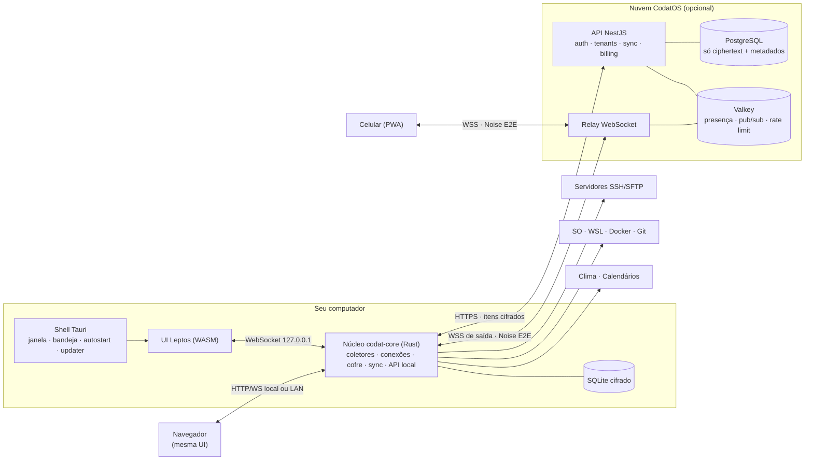
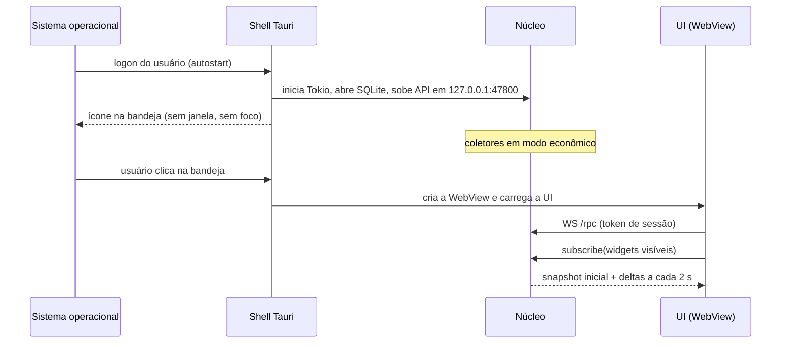
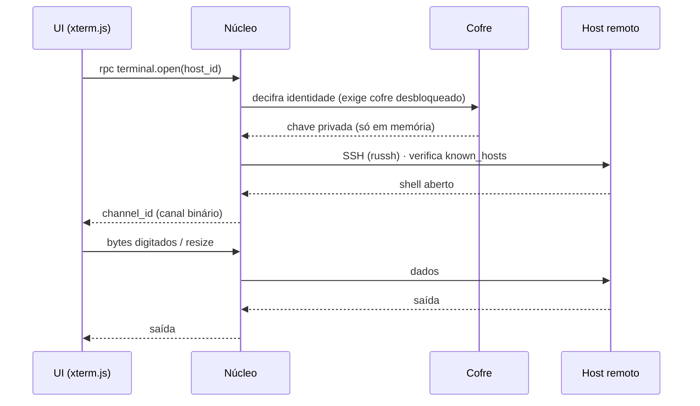
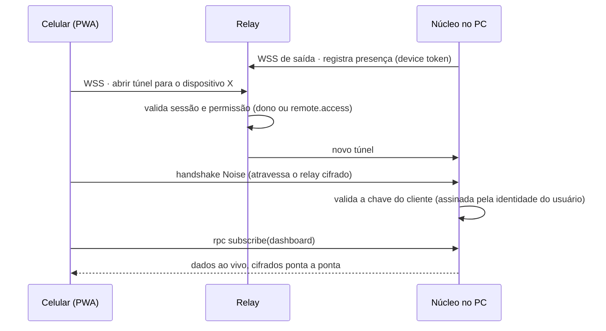

# 02 · Arquitetura

> **Status:** Rascunho · **Versão:** 0.1 · **Atualizado:** 2026-10-14
> ← [Requisitos](01-requisitos.md) · [Índice](README.md) · Próximo: [Stack](03-stack.md) →

## Visão geral

O CodatOS tem **um núcleo local em Rust** que faz todo o trabalho (coletar métricas, conectar em servidores, guardar o cofre, sincronizar) e expõe **uma única API** (HTTP + WebSocket). Todas as interfaces — a janela do app, o navegador e o celular — são **a mesma UI** falando com essa API. A nuvem é opcional e "burra": guarda dados cifrados, gerencia contas/tenants e encaminha bytes do acesso remoto.



## Componentes

| Componente | Tecnologia | Responsabilidade | Decisão |
|---|---|---|---|
| **Shell desktop** | Tauri 2 | Janela sem moldura, bandeja, autostart, instância única, atalhos globais, deep links, atualização assinada | [ADR-0002](adr/0002-tauri-e-leptos.md) |
| **UI** | Leptos (Rust → WASM) + Tailwind | Todas as telas. Um único bundle servido para desktop, navegador e PWA | [ADR-0002](adr/0002-tauri-e-leptos.md) |
| **Núcleo (`codat-core`)** | Rust + Tokio + Axum | API local, coletores, conexões SSH/SFTP, cofre, sync, cliente do relay, notificações | [ADR-0003](adr/0003-agente-local-api-unica.md) |
| **Banco local** | SQLite (SQLCipher) via sqlx | Configurações e dados (financeiro, tarefas), segredos cifrados | [ADR-0005](adr/0005-local-first.md) |
| **API da nuvem** | NestJS + PostgreSQL + Valkey | Contas, dispositivos, tenants/grupos/permissões, armazenamento de itens cifrados, assinatura | [ADR-0006](adr/0006-nestjs-postgres.md) |
| **Relay** | Módulo WebSocket da nuvem | Presença dos dispositivos e encaminhamento de túneis cifrados ponta a ponta | [ADR-0007](adr/0007-relay-noise.md) |
| **PWA** | A mesma UI, servida pela nuvem | Cliente remoto no celular | [Acesso remoto](modulos/acesso-remoto.md) |
| **Site** | Astro + Tailwind | Apresentação, downloads, preços | [ADR-0008](adr/0008-site-astro.md) |

## Modelo de processos

- **Um processo** no MVP: o Tauri hospeda o runtime Tokio do núcleo. Fechar a janela **destrói a WebView** (economia de RAM) e o núcleo continua na bandeja servindo a API, mantendo túneis e sessões.
- A UI conversa com o núcleo pelo **mesmo WebSocket** que o navegador usa, mesmo dentro do Tauri. Isso garante um único caminho de código; o IPC nativo do Tauri fica restrito a funções do shell (janela, bandeja, diálogos de arquivo).
- **Futuro**: um *helper* privilegiado opcional (`codat-helper`) para sensores que exigem admin/driver (temperatura no Windows), com IPC mínimo por named pipe/socket Unix — ver [Sistema](modulos/sistema.md#temperatura-e-energia-no-windows).

## Camada de transporte da UI

A UI não sabe onde o núcleo está. Ela usa uma abstração `Transport` com duas implementações:

| Transporte | Usado em | Como |
|---|---|---|
| `LocalWs` | Desktop, navegador local e LAN | WebSocket direto em `/rpc` com cookie/token de sessão |
| `RelayNoise` | PWA no celular / navegador remoto | WebSocket para o relay + sessão Noise com o PC; o mesmo protocolo RPC dentro do canal cifrado |

O núcleo anuncia sua versão e suas **capacidades** (ex.: `wsl`, `docker`, `nvml`) no início da sessão; a UI oculta o que o dispositivo não suporta.

## Coletores

Cada fonte de dados do sistema é um coletor independente:

```rust
// crates/core/src/collector.rs; implementações em crates/collectors
pub trait Collector: Debug + Send + Sync + 'static {
    /// "system.metrics", "disks", "wsl.distros", "docker.containers"…
    fn topic(&self) -> &'static str;
    fn intervals(&self) -> Intervals { /* padrão 2 s, mínimo 500 ms */ }
    fn timeout(&self) -> Duration { Duration::from_secs(5) }
    fn collect(&self) -> CollectFuture<'_>; // Result<serde_json::Value, CollectError>
}
```

Coletores que só existem numa plataforma (WSL no Windows) simplesmente não entram na lista daquela plataforma.

- **Sob demanda**: o agendador conta assinaturas por tópico; sem ninguém assistindo e sem alertas configurados, o coletor não roda (RNF-DES-03).
- **Isolamento**: cada coleta tem *timeout*, *backoff* exponencial e erro próprio; um coletor travado não afeta os outros (RNF-CON-02).
- **Cache e histórico**: último snapshot em memória para respostas instantâneas; *ring buffer* de 1 h para gráficos.
- **Deltas**: a UI recebe o snapshot inicial e depois só o que mudou.

## Fluxos principais

### Inicialização com o sistema



### Sessão SSH



A chave privada nunca chega à UI; o mesmo vale quando a UI está num navegador ou no celular.

### Acesso remoto pelo celular



Detalhes de sincronização e do relay em [APIs e protocolos](06-api-e-protocolos.md).

## Onde os dados ficam no disco

| SO | Configuração e dados | Logs |
|---|---|---|
| Windows | `%APPDATA%\CodatOS` | `%LOCALAPPDATA%\CodatOS\logs` |
| macOS | `~/Library/Application Support/CodatOS` | `~/Library/Logs/CodatOS` |
| Linux | `$XDG_DATA_HOME/codatos` e `$XDG_CONFIG_HOME/codatos` | `$XDG_STATE_HOME/codatos/logs` |

## Estrutura do monorepo (planejada)

```text
codatos/
├── apps/
│   ├── desktop/        # Shell Tauri 2 (src-tauri): janela, bandeja, autostart, updater
│   ├── ui/             # UI Leptos (CSR → WASM) — desktop, navegador e PWA
│   ├── cloud/          # API NestJS + relay (TypeScript)
│   └── site/           # Landing page (Astro)
├── crates/
│   ├── core/           # Orquestração: runtime, API local (Axum), eventos, agendador
│   ├── collectors/     # sysinfo, NVML, WSL, Docker, git, editores
│   ├── connections/    # SSH, SFTP, túneis, PTY local (russh, portable-pty)
│   ├── vault/          # Cofre: Argon2id, envelopes XChaCha20 v1, header (desde o M2)
│   ├── crypto/         # X25519, Ed25519, Noise (nasce com o sync e o relay)
│   ├── sync/           # Cliente de sincronização, fila offline, merge
│   ├── store/          # SQLite (sqlx), migrações
│   └── protocol/       # Tipos da API local, sync e relay (gera tipos TS para a nuvem)
├── deploy/             # docker-compose (dev e self-host), Caddyfile
├── docs/               # Documentação (você está aqui)
├── vault/              # Vault do Obsidian (cérebro do projeto)
└── .github/            # CI, templates de issue/PR
```

O crate `protocol` é a fonte da verdade dos contratos: gera tipos TypeScript (via `ts-rs`/`specta`) consumidos pela nuvem, evitando divergência entre Rust e NestJS. Ver [ADR-0001](adr/0001-monorepo.md).
