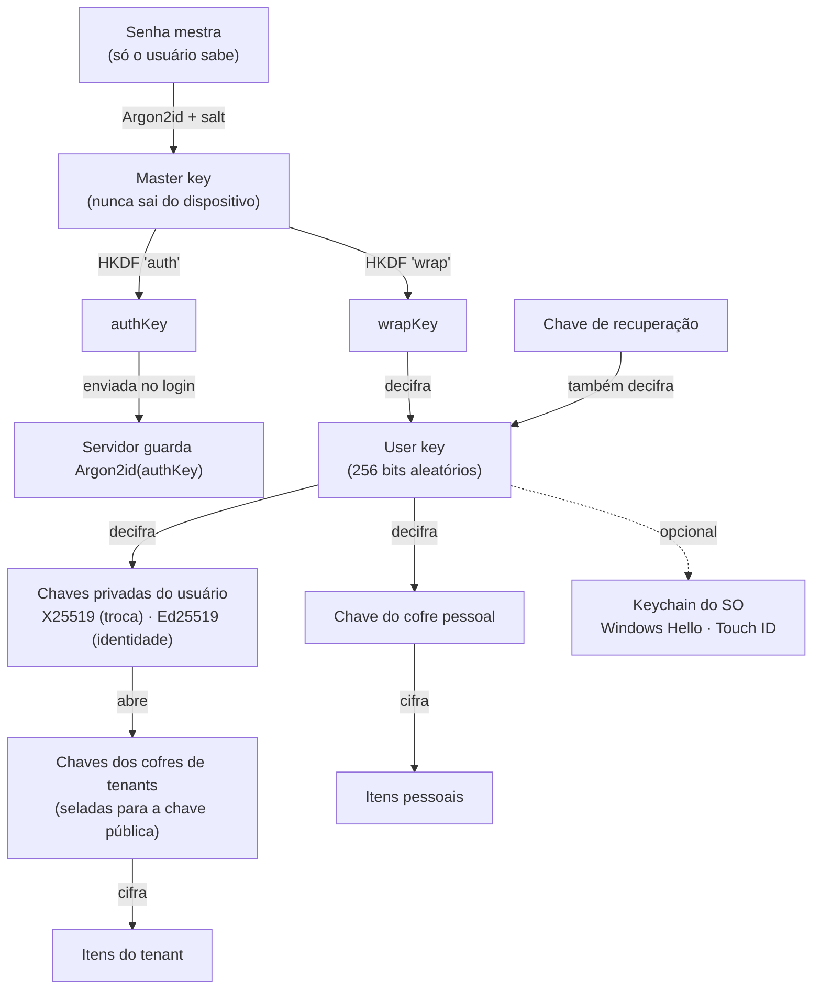

# 04 · Segurança e privacidade

> **Status:** Rascunho · **Versão:** 0.1 · **Atualizado:** 2026-10-14
> ← [Stack](03-stack.md) · [Índice](README.md) · Próximo: [Modelo de dados](05-modelo-de-dados.md) →
> Decisão base: [ADR-0004 · Criptografia ponta a ponta](adr/0004-criptografia-ponta-a-ponta.md)

## 1. Princípios

1. **O servidor não precisa ser confiável para seus dados continuarem secretos.** Ele guarda apenas texto cifrado e metadados mínimos.
2. **Segredos só existem em claro dentro do núcleo Rust**, em memória, pelo menor tempo possível.
3. **Nada de criptografia caseira**: primitivas padrão, bibliotecas auditadas, formatos versionados.
4. **Defesa em camadas**: disco cifrado + cofre com desbloqueio + permissões + auditoria.
5. **Honestidade sobre limites**: o que não protegemos é documentado (ver [§11](#11-modelo-de-ameaças)).

## 2. Hash vs criptografia

O pedido original foi "esconder senhas, chaves e tokens com métodos de hash". O objetivo — **ninguém além de você consegue ler** — está certo; a ferramenta precisa ser a adequada para cada caso:

| O quê | Técnica | Por quê |
|---|---|---|
| Senha de login (mestra) | **Hash** — Argon2id no cliente e de novo no servidor | Só precisamos *conferir*; ninguém precisa "ler" a senha |
| Senhas de servidores, chaves SSH, passphrases, tokens OAuth/API | **Criptografia ponta a ponta** — XChaCha20-Poly1305 | Precisam ser *recuperadas* para conectar; um hash não pode ser revertido |
| Configurações sincronizadas (hosts, layouts, preferências) | **Criptografia ponta a ponta** | Mesmo motivo; e o servidor também não deve ver nomes e IPs |
| Refresh tokens e códigos de convite no servidor | **Hash** (SHA-256) | Servidor só confere |
| Segredo TOTP (2FA) no servidor | Criptografia com chave do servidor | O servidor precisa validar o código |

Resultado prático: **um vazamento total do banco da nuvem não expõe nenhuma senha, chave, host ou configuração**.

## 3. Hierarquia de chaves



| Chave | Origem | Onde vive |
|---|---|---|
| **Master key** | Argon2id(senha, salt) — parâmetros mínimos m=64 MiB, t=3, p=4 | Só em memória durante o desbloqueio |
| **authKey** | HKDF(master, "auth") | Enviada no login; o servidor guarda **Argon2id(authKey)** |
| **wrapKey** | HKDF(master, "wrap") | Só em memória |
| **User key** | Aleatória (CSPRNG) no cadastro | Servidor guarda cifrada pela wrapKey e pela chave de recuperação |
| **Par X25519** | Aleatório | Pública no servidor; privada cifrada pela user key |
| **Par Ed25519 (identidade)** | Aleatório | Assina chaves de dispositivos e de sessões remotas |
| **Chave de cofre** | Aleatória, uma por cofre (inclusive o pessoal) | Pessoal: cifrada pela user key. Tenant: selada para a chave pública de cada membro |
| **Chaves de dispositivo** | Par X25519/Ed25519 por instalação | Privada no keychain do SO; pública registrada e assinada pela identidade do usuário |

Trocar a senha mestra só re-cifra a user key; os itens não precisam ser re-cifrados.

## 4. Formato dos dados cifrados

Cada item sincronizável (um host, uma identidade, um layout…) é serializado e cifrado inteiro:

```json
{
  "v": 1,
  "alg": "XC20P",
  "kid": "vault:01J9Z…:k3",
  "nonce": "base64(24 bytes aleatórios)",
  "ct": "base64(ciphertext + tag)"
}
```

- AEAD **XChaCha20-Poly1305**, nonce aleatório de 192 bits.
- **AAD** = `item_id ‖ vault_id ‖ versão do formato` — impede que o servidor mova um item cifrado para outro cofre ou troque itens entre si sem ser detectado.
- O **tipo** do item fica dentro do texto cifrado; o servidor vê apenas `id`, `vault_id`, revisão, tamanho e datas.
- Limite de 64 KiB por item (R-01).

## 5. Fluxos

**Cadastro** — o cliente gera salt, user key, pares de chaves e chave de recuperação; deriva master/auth/wrap; envia ao servidor: e-mail, parâmetros de KDF, authKey, user key cifrada (pela wrapKey e pela chave de recuperação), chaves públicas e privadas cifradas. A chave de recuperação é exibida **uma única vez**.

**Login** — `prelogin(email)` devolve parâmetros de KDF → o cliente deriva a authKey → servidor confere com Argon2id → devolve tokens e as chaves cifradas → o cliente decifra localmente. Com GitHub OAuth, a autenticação acontece pelo GitHub, mas o **desbloqueio** do cofre continua exigindo a senha mestra (ou biometria já configurada no dispositivo).

**Desbloqueio rápido** — opcional: a user key é guardada no keychain do SO protegida por Windows Hello/Touch ID/senha da sessão.

**Recuperação** — com a chave de recuperação, o cliente decifra a user key e define nova senha mestra. Sem ela, só resta redefinir a conta (dados da nuvem apagados; dados locais intactos).

**Compartilhar com um tenant** — o admin cria a chave do cofre do tenant e a **sela** (X25519 sealed box) para a chave pública de cada membro. Para evitar que um servidor malicioso troque a chave pública de um convidado, a UI mostra a **impressão digital** da chave para verificação opcional fora do app (transparência de chaves fica para o futuro).

**Remover membro** — o servidor revoga o acesso imediatamente; o cliente de um admin gera nova chave do cofre, re-sela para os membros restantes e re-cifra os itens gradualmente. O membro removido pode ter guardado o que já viu — isso é inerente e documentado.

**Novo dispositivo** — o dispositivo gera seu par de chaves; após o desbloqueio, a identidade Ed25519 do usuário assina a chave pública do dispositivo. Outros dispositivos e o relay só aceitam dispositivos com assinatura válida.

## 6. O que o servidor vê (e o que não vê)

| Vê | Não vê |
|---|---|
| E-mail, nome, data de criação | Senha mestra (nem o hash dela) |
| Tenants, membros, grupos e permissões | Hosts, IPs, usuários, senhas, chaves SSH |
| Dispositivos (nome, plataforma, último acesso) | Configurações, layouts, preferências |
| Quantidade, tamanho e datas dos itens cifrados | Dados financeiros, tarefas, calendário, clima |
| Status da assinatura (ID no provedor de pagamento) | Conteúdo de terminal, arquivos SFTP, métricas do PC |
| IP de acesso (retenção máx. 14 dias) | Qualquer coisa trafegada pelo relay |

## 7. Segurança local

- **Banco cifrado em repouso** (SQLCipher). A chave do banco fica no keychain do SO (Credential Manager/DPAPI, Keychain, Secret Service).
- **Segredos com segunda camada**: senhas, chaves e tokens são cifrados também com a chave do cofre, que exige **desbloqueio** (senha mestra/PIN/biometria). Sem conta, o usuário escolhe: cofre protegido só pela sessão do SO (conveniente) ou por senha própria (mais forte).
- **Bloqueio automático** por inatividade (padrão 15 min), ao bloquear a sessão do SO e ao suspender.
- **Memória**: `secrecy`/`zeroize` para limpar segredos; nenhum segredo em logs, crash dumps ou na UI.
- **A UI nunca recebe chaves privadas**; "revelar senha" exige reautenticação e a permissão `connections.reveal`.

## 8. API local

Uma API em `localhost` é alvo clássico de sites maliciosos abertos no navegador. Mitigações:

- Escuta só em `127.0.0.1` por padrão.
- **Token de sessão obrigatório** em toda chamada; "Abrir no navegador" usa token de uso único → cookie `HttpOnly`, `Secure` (no modo LAN), `SameSite=Strict`.
- Validação de cabeçalho **`Host`** (anti DNS rebinding) e de **`Origin`** no WebSocket; sem CORS.
- Modo LAN: opt-in, TLS com certificado do dispositivo, pareamento por QR code, *rate limit* e lista de clientes pareados.
- CSP restritiva na UI servida; nenhuma dependência carregada de CDN.

## 9. Relay e acesso remoto

- O PC abre conexão **de saída**; nenhuma porta aberta.
- Canal **Noise** (`Noise_XX_25519_ChaChaPoly_BLAKE2s`) de ponta a ponta entre cliente e PC; o relay não tem as chaves.
- O cliente remoto (PWA) gera um par de chaves **efêmero** por sessão, assinado pela identidade Ed25519 do usuário após o desbloqueio. O PC só aceita chaves assinadas pela identidade que ele conhece — **nem o servidor consegue se passar por você**.
- Membros de tenant com `remote.access` são validados pelo próprio PC, a partir da lista de membros assinada.
- Ações sensíveis exigem confirmação/reautenticação e notificam o PC; sessões remotas são visíveis e encerráveis.

## 10. Nuvem

- TLS 1.3, HSTS, cabeçalhos de segurança; *rate limiting* e bloqueio progressivo; 2FA e passkeys.
- Refresh tokens rotativos com **detecção de reuso** (reuso revoga a família inteira); armazenados como hash.
- PostgreSQL com **Row-Level Security** por tenant e usuário; segredos do servidor em variáveis de ambiente/secret manager; backups cifrados.
- **Risco da PWA**: um cliente web executa o código que o servidor entrega; um servidor comprometido poderia servir JavaScript/WASM malicioso para capturar a senha mestra. Mitigações: builds reprodutíveis com *hashes* publicados em cada release, Subresource Integrity, CSP estrita, PWA com service worker que fixa a versão, e recomendação explícita do **app desktop** para quem busca a máxima segurança. O app desktop nunca carrega código da nuvem.

## 11. Modelo de ameaças

| Ator / cenário | Ameaça | Mitigação | Residual |
|---|---|---|---|
| Ladrão do notebook (desligado) | Ler dados locais | SQLCipher + cofre bloqueado | Baixo |
| Ladrão com sessão aberta | Usar o app | Bloqueio automático; reautenticação para revelar segredos | Médio (janela até o bloqueio) |
| Malware no PC | Ler memória, capturar teclas | Fora do escopo — com o SO comprometido nenhum app local se defende totalmente | Alto (documentado) |
| Banco da nuvem vazado | Ler segredos e configurações | Zero-knowledge; Argon2id duplo dificulta força bruta da senha | Baixo (metadados expostos) |
| Admin/servidor malicioso | Trocar chaves públicas, servir PWA maliciosa, *rollback* de itens | Impressões digitais, assinaturas de dispositivo, SRI/hashes, revisões no AAD | Médio na PWA; baixo no desktop |
| Atacante de rede | MITM | TLS 1.3; Noise; known_hosts no SSH | Baixo |
| Site malicioso no navegador | Chamar a API local | Token, Host/Origin, SameSite, sem CORS | Baixo |
| Membro removido do tenant | Continuar acessando | Revogação + rotação de chave | Conteúdo já visto |
| Celular perdido | Acessar o PC | Revogar dispositivo; PWA com bloqueio; sessão curta | Baixo |
| Cadeia de suprimentos | Dependência comprometida | cargo-deny/audit, lockfiles, Renovate revisado, builds reprodutíveis, SBOM | Médio |

## 12. LGPD

- Base legal: execução de contrato (conta/assinatura) e consentimento (telemetria opcional).
- Direitos do titular self-service: acesso/exportação, correção, exclusão (RF-CONTA-012).
- Dados cifrados de ponta a ponta reduzem drasticamente o impacto de incidentes.
- Encarregado (DPO) e canal de contato definidos antes do lançamento do plano pago.

## 13. Processo de segurança

- Política de divulgação responsável em [SECURITY.md](../SECURITY.md).
- Revisão obrigatória por um segundo par de olhos em PRs que tocam `crypto`, `vault`, `sync`, relay e auth.
- Vetores de teste para todos os formatos criptográficos; *fuzzing* dos parsers (cargo-fuzz).
- Auditoria externa desejável antes da 1.0 do plano pago.
