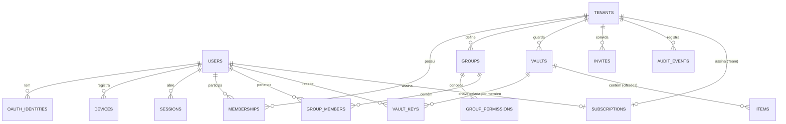

# 05 · Modelo de dados

> **Status:** Rascunho · **Versão:** 0.1 · **Atualizado:** 2026-10-14
> ← [Segurança](04-seguranca.md) · [Índice](README.md) · Próximo: [APIs e protocolos](06-api-e-protocolos.md) →

## Convenções

- IDs **UUIDv7** (ordenáveis por tempo), gerados no cliente — permitem criar itens offline.
- Datas em UTC (`timestamptz` / ISO 8601).
- Valores monetários em **centavos** (`INTEGER`), nunca ponto flutuante.
- Cada registro sincronizável local corresponde a **um item cifrado** na nuvem, com o mesmo ID.

## Banco local (SQLite)

Arquivo único cifrado (SQLCipher) por perfil de usuário. Colunas marcadas com 🔒 são cifradas **também** com a chave do cofre (exigem desbloqueio). No banco elas aparecem com o sufixo `_sealed` (ex.: `password_sealed`) e guardam o envelope JSON do cofre, com o id da linha na AAD.

### Núcleo e preferências

| Tabela | Campos principais | Sync |
|---|---|---|
| `settings` | `key`, `value` (JSON), `scope` (`global`/`device`) | Só `global` |
| `tenants` | `id`, `name`, `icon`, `remote_id` (se na nuvem), `archived_at` | Sim |
| `dashboards` | `id`, `tenant_id`, `name`, `position` | Sim |
| `widgets` | `id`, `dashboard_id`, `kind`, `layout` (JSON por breakpoint), `config` (JSON) | Sim |
| `notifications` | `id`, `kind`, `title`, `body`, `read_at` | Não |
| `alert_rules` | `id`, `tenant_id`, `metric`, `condition`, `duration`, `enabled` | Sim |

### Conexões

| Tabela | Campos principais | Sync |
|---|---|---|
| `host_groups` | `id`, `tenant_id`, `parent_id`, `name`, `defaults` (JSON) | Sim |
| `hosts` | `id`, `tenant_id`, `group_id`, `name`, `address`, `port`, `protocol`, `identity_id`, `jump_host_id`, `tags`, `advanced` (JSON), `last_used_at` | Sim |
| `identities` | `id`, `tenant_id`, `name`, `username`, `password` 🔒, `key_id` | Sim |
| `ssh_keys` | `id`, `tenant_id`, `name`, `algorithm`, `public_key`, `private_key` 🔒, `passphrase` 🔒, `fingerprint` | Sim |
| `known_hosts` | `host_pattern`, `key_type`, `fingerprint`, `first_seen_at` | Sim |
| `snippets` | `id`, `tenant_id`, `name`, `command` (variáveis são os `{{nome}}` do comando) | Sim |
| `tunnels` | `id`, `host_id`, `kind` (L/R/D), `bind`, `target`, `autostart` | Sim |

### Financeiro

| Tabela | Campos principais | Sync |
|---|---|---|
| `fin_accounts` | `id`, `tenant_id`, `name`, `kind`, `currency`, `opening_balance_cents`, `closing_day`, `due_day` | [Q-07](10-perguntas-em-aberto.md#financeiro) |
| `fin_categories` | `id`, `tenant_id`, `parent_id`, `name`, `color`, `icon`, `kind` | idem |
| `fin_transactions` | `id`, `account_id`, `category_id`, `date`, `description`, `amount_cents`, `kind`, `transfer_peer_id`, `recurrence_id`, `installment` , `import_hash` | idem |
| `fin_rules` | `id`, `pattern`, `category_id` | idem |
| `fin_budgets` | `id`, `category_id`, `month`, `limit_cents` | idem |

### Tarefas, integrações e projetos

| Tabela | Campos principais | Sync |
|---|---|---|
| `task_fields` / `task_field_options` | `tenant_id`, `type` (status/area/materia/category/custom), `name`; opções com `name`, `slug`, `color`, `sort_order`, `archived` — herdado do TaskHub | [Q-05](10-perguntas-em-aberto.md#taskhub) |
| `task_projects` | `id`, `tenant_id`, `name`, `description`, `color`, `sync_mode` (local/hybrid/github), `local_project_id` | idem |
| `tasks` | `id`, `project_id`, `title`, `body`, `status_option_id`, `priority`, `start_date`, `due_date`, `sort_order`, `field_values` (JSON para campos extras), `parent_id` (subtarefas) | idem |
| `task_sync_connections` / `task_external_mappings` | Provedor (GitHub Projects), configuração, token 🔒, último sync; mapeamento `local_id` ↔ `external_id` | Configuração sim; token cifrado |
| `calendar_sources` | `id`, `kind` (ics/google/ms/caldav), `url`, `token` 🔒, `calendars` (JSON) | Sim |
| `weather_locations` | `id`, `name`, `lat`, `lon`, `provider` | Sim |
| `project_roots` | `id`, `path`, `depth`, `ignore` | Não (por dispositivo) |
| `projects` | `id`, `path`, `remote_url`, `pinned`, `tags`, `last_seen_at` | Só preferências (`pinned`, `tags`) por `remote_url` |

### Sync

| Tabela | Uso |
|---|---|
| `sync_state` | Cursor da última sincronização por cofre |
| `sync_outbox` | Alterações locais pendentes: `item_id`, `base_revision`, `snapshot` (para merge 3-way) |
| `sync_conflicts` | Cópias em conflito aguardando decisão do usuário |

## Nuvem (PostgreSQL)



### Tabelas principais

```sql
create table users (
  id                       uuid primary key,          -- UUIDv7
  email                    citext unique not null,
  name                     text,
  email_verified_at        timestamptz,
  kdf                      jsonb not null,            -- {"alg":"argon2id","m":65536,"t":3,"p":4,"salt":"…"}
  auth_hash                text not null,             -- Argon2id(authKey) calculado no servidor
  protected_user_key       bytea not null,            -- user key cifrada pela wrapKey
  recovery_user_key        bytea not null,            -- user key cifrada pela chave de recuperação
  public_key               bytea not null,            -- X25519
  protected_private_key    bytea not null,            -- cifrada pela user key
  identity_public_key      bytea not null,            -- Ed25519
  protected_identity_key   bytea not null,            -- cifrada pela user key
  totp_secret_enc          bytea,                     -- cifrado com chave do servidor
  created_at               timestamptz not null default now()
);

create table devices (
  id            uuid primary key,
  user_id       uuid not null references users(id) on delete cascade,
  name          text not null,
  platform      text not null,                        -- windows | macos | linux | web
  public_key    bytea not null,
  signature     bytea not null,                       -- assinatura pela identidade do usuário
  remote_enabled boolean not null default false,
  last_seen_at  timestamptz,
  revoked_at    timestamptz
);

create table tenants (
  id         uuid primary key,
  name       text not null,
  owner_id   uuid not null references users(id),
  personal   boolean not null default false,
  created_at timestamptz not null default now(),
  archived_at timestamptz
);

create table memberships (
  tenant_id  uuid references tenants(id) on delete cascade,
  user_id    uuid references users(id) on delete cascade,
  status     text not null,                           -- invited | active | suspended
  joined_at  timestamptz,
  primary key (tenant_id, user_id)
);

create table groups (
  id          uuid primary key,
  tenant_id   uuid not null references tenants(id) on delete cascade,
  name        text not null,
  description text,
  system      boolean not null default false,          -- Administradores / Visualizadores
  unique (tenant_id, name)
);

create table group_permissions (
  group_id   uuid references groups(id) on delete cascade,
  permission text not null,                            -- ex.: 'connections.use'
  scope      jsonb not null default '{}',              -- {} = tenant inteiro; {"folder":"…"} etc.
  primary key (group_id, permission, scope)
);

create table group_members (
  group_id uuid references groups(id) on delete cascade,
  user_id  uuid references users(id) on delete cascade,
  primary key (group_id, user_id)
);

create table vaults (
  id         uuid primary key,
  tenant_id  uuid not null references tenants(id) on delete cascade,
  key_version int not null default 1
);

create table vault_keys (
  vault_id    uuid references vaults(id) on delete cascade,
  user_id     uuid references users(id) on delete cascade,
  key_version int not null,
  sealed_key  bytea not null,                          -- chave do cofre selada p/ a chave pública do usuário
  primary key (vault_id, user_id, key_version)
);

create table items (
  id          uuid primary key,
  vault_id    uuid not null references vaults(id) on delete cascade,
  revision    bigint not null,
  seq         bigserial,                               -- cursor global de sincronização
  ciphertext  bytea check (octet_length(ciphertext) <= 65536),  -- R-01
  deleted     boolean not null default false,          -- tombstone
  updated_by_device uuid references devices(id),
  updated_at  timestamptz not null default now()
);
create index on items (vault_id, seq);
```

Demais tabelas: `oauth_identities`, `sessions` (refresh token **hash**, família, expiração), `invites` (token **hash**, grupos iniciais, expiração), `subscriptions` (provedor, IDs externos, plano, status, fim do período), `audit_events` (tenant, ator, ação, alvo, data — sem conteúdo).

### Isolamento com RLS

```sql
alter table items enable row level security;

create policy items_by_vault_access on items
  using (exists (
    select 1 from vault_keys k
    where k.vault_id = items.vault_id
      and k.user_id = current_setting('app.user_id')::uuid
  ));
```

A API define `app.user_id` (e `app.tenant_id` quando aplicável) por transação; mesmo um bug na camada de aplicação não vaza linhas de outro usuário.

### Retenção

| Dado | Retenção |
|---|---|
| Itens excluídos (tombstones) | 90 dias, depois removidos |
| Contas sem assinatura com dados sincronizados | 90 dias após o fim do plano, com avisos |
| Logs com IP | 14 dias |
| Auditoria de tenant | 90 dias (configurável no Team) |
| Contas excluídas | Remoção imediata; backups expiram em 30 dias |
