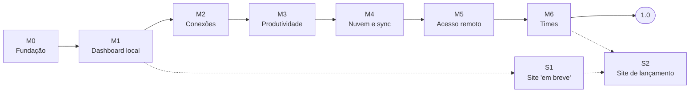

# 09 · Roadmap

> **Status:** Rascunho · **Versão:** 0.1 · **Atualizado:** 2026-10-17
> ← [Site](08-site.md) · [Índice](README.md) · Próximo: [Perguntas em aberto](10-perguntas-em-aberto.md) →

A ordem prioriza **usar o app no dia a dia o quanto antes** (dashboard local), depois o que substitui ferramentas pagas (conexões), e só então a nuvem. Sem datas: cada marco termina quando seus critérios de saída são atendidos.

## M0 · Fundação

- Monorepo, CI em matriz (Windows/macOS/Linux), lint, formatação, release-please, Renovate.
- Shell Tauri + UI Leptos "hello", tokens do design system, sidebar e topbar.
- Núcleo com Axum em `127.0.0.1`, WebSocket RPC, autostart, bandeja, instância única, janela destruída ao fechar.
- **Saída**: instalador assinado (ao menos Windows) que inicia com o sistema e abre uma janela vazia no visual do mockup; RAM em repouso medida.
- **Situação (2026-10-17)**: ✅ concluído, exceto a **assinatura** do instalador, que espera a [Q-29](10-perguntas-em-aberto.md) (o workflow de release já assina quando os secrets existirem). RAM em repouso: 30 MB ([medição](benchmarks/m0.md)).

## M1 · Dashboard local

- Coletores: CPU/RAM/GPU (NVML), discos, rede, WSL (estado, tamanho, ações), Docker (host + WSL, deduplicado), projetos (raízes + VS Code/JetBrains).
- Clima (Open-Meteo). Grade de widgets com modo edição. Onboarding. Acesso pelo navegador local com token.
- **Saída**: o autor usa o dashboard diariamente no Windows; RNF-DES-01/02 atendidos.
- **Situação (2026-10-17)**: código completo nas PRs #13 a #30 ([plano do M1](https://claude.ai/code/artifact/bccd5d5d-70fb-446f-badd-91b08dd9bbfb)); Q-14, Q-15, Q-25 e Q-30 decididas. Falta medir o RNF-DES-01/02 no Windows ([medições do M1](benchmarks/m1.md)) e o autor passar a usar o dashboard no dia a dia.

## M2 · Conexões

- Hosts, grupos, identidades, chaves, known hosts, importação de `~/.ssh/config`, terminal em abas/painéis, terminais locais/WSL/Docker, SFTP de painel duplo, jump hosts, túneis, snippets.
- Cofre local com desbloqueio (senha/PIN/biometria) e export cifrado.
- **Saída**: o autor substitui o Termius no dia a dia.

## M3 · Produtividade

- Financeiro (contas, transações, OFX/CSV, categorias, visão geral, metas).
- TaskHub refeito em Rust (o projeto atual é só referência): Kanban, Tabela, Roadmap, campos personalizados, sync com GitHub Projects; importador opcional dos dados atuais.
- Calendário (ICS e Google), notificações, alertas por limite, tenants locais, múltiplos dashboards, modo LAN.
- **Saída**: dashboard do mockup v0 completo com dados reais.

## M4 · Nuvem e sync

- API NestJS: cadastro/login com KDF no cliente, GitHub OAuth, 2FA, chave de recuperação, dispositivos.
- Cofres e itens cifrados, sync incremental com merge, tela de sincronização, Stripe, exportação/exclusão de conta.
- `docker compose` de self-host documentado.
- **Saída**: dois PCs sincronizam conexões e layouts; dump do banco não revela nada legível; revisão de segurança interna concluída.

## M5 · Acesso remoto

- Relay, presença, Noise, PWA com lista de dispositivos, dashboard e ações remotas, notificações no PC, indicador de sessão.
- **Saída**: controlar o PC de casa pelo 4G com latência dentro da meta.

## M6 · Times

- Tenants na nuvem, convites, membros, grupos, catálogo de permissões, cofres compartilhados com rotação de chave, auditoria, plano Team.
- **Saída**: um tenant "Trabalho" com 3 pessoas compartilhando hosts com permissões diferentes.

## 1.0

- Auditoria de segurança (externa, se houver orçamento), site de lançamento (S2), documentação pública, pacotes winget/Homebrew/Flatpak.

## Trilha do site

- **S0** ✅: [protótipo do hero com o mosaico](../apps/site/prototypes/mosaico.html) (HTML puro, para validar o visual).
- **S1** (junto com M1): landing "em breve" com mosaico, lista de espera opcional e link para o GitHub. Feita em `apps/site` (Astro); a lista de espera ficou para depois e a publicação espera o domínio ([Q-01](10-perguntas-em-aberto.md)).
- **S2** (junto com 1.0): site completo com downloads, preços, segurança, changelog e docs.

## Riscos

| Risco | Impacto | Mitigação |
|---|---|---|
| Temperatura/energia no Windows exige driver | Widget incompleto | Modo sem privilégio + integração opcional com LibreHardwareMonitor ([Q-13](10-perguntas-em-aberto.md#sistema)) |
| Maturidade do Leptos (componentes, interop) | Ritmo da UI | Spike no M0; componentes próprios (gráficos, grade); API do núcleo independente da UI ([ADR-0002](adr/0002-tauri-e-leptos.md)) |
| Cross-compilação do app Windows a partir do WSL (`cargo-xwin`) não funcionar bem com o Tauri | Testes de recursos do Windows mais lentos | Validar logo no M0; alternativa: CI com runner Windows ([Q-35](10-perguntas-em-aberto.md#infraestrutura-e-custos)) |
| Custo de assinatura de código (Windows/Apple) | Alertas do SmartScreen/Gatekeeper | Começar com Windows; avaliar Azure Trusted Signing e conta Apple Developer ([Q-29](10-perguntas-em-aberto.md#infraestrutura-e-custos)) |
| Verificação do Google para `calendar.readonly` | Atraso na integração | Começar com ICS; submeter verificação cedo |
| Licença de APIs de terceiros (clima) no plano pago | Bloqueio legal | MET Norway como alternativa ([Q-30](10-perguntas-em-aberto.md#infraestrutura-e-custos)) |
| Diferenças entre WebViews (WebKitGTK) | Bugs visuais no Linux | Testes visuais no CI; matriz de SOs |
| Complexidade criptográfica | Bugs graves de segurança | Bibliotecas auditadas, vetores de teste, revisão dupla, auditoria antes do plano pago |
| Custo de banda do relay | Margem do plano Pro | Limites por plano; P2P (WebRTC) futuro |
| Escopo grande para uma pessoa | Projeto não sai | Marcos que entregam valor sozinhos; comunidade a partir do M1 |
